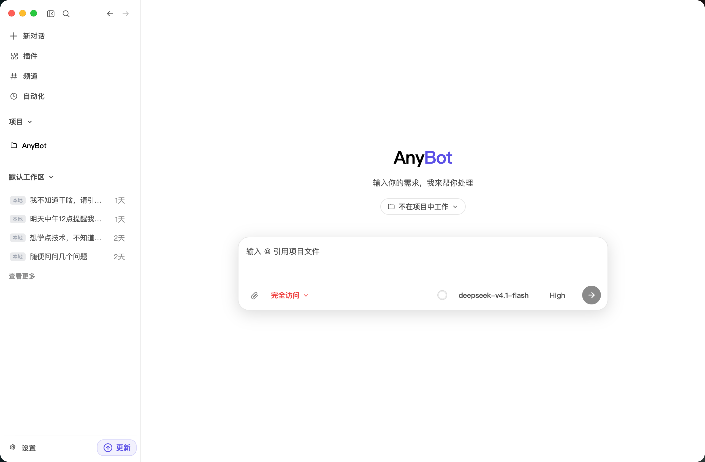
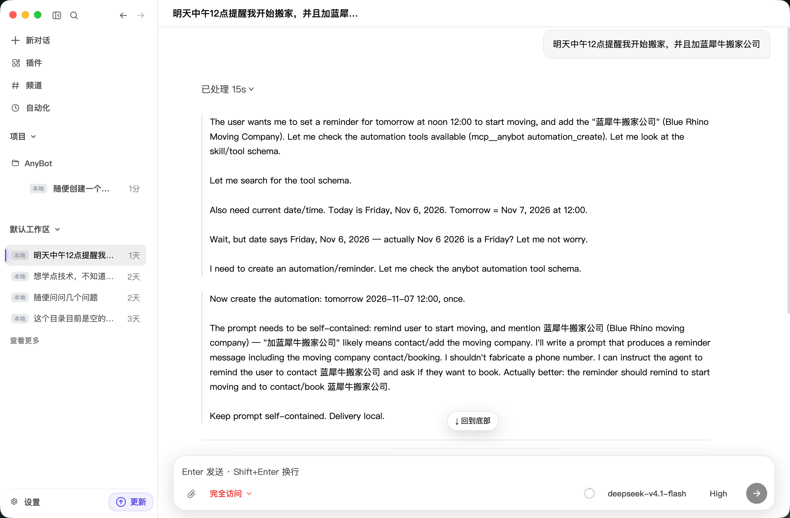
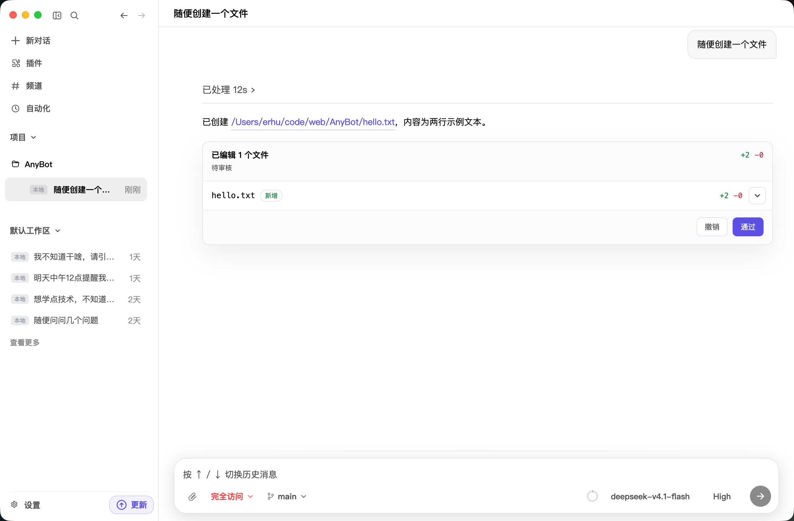
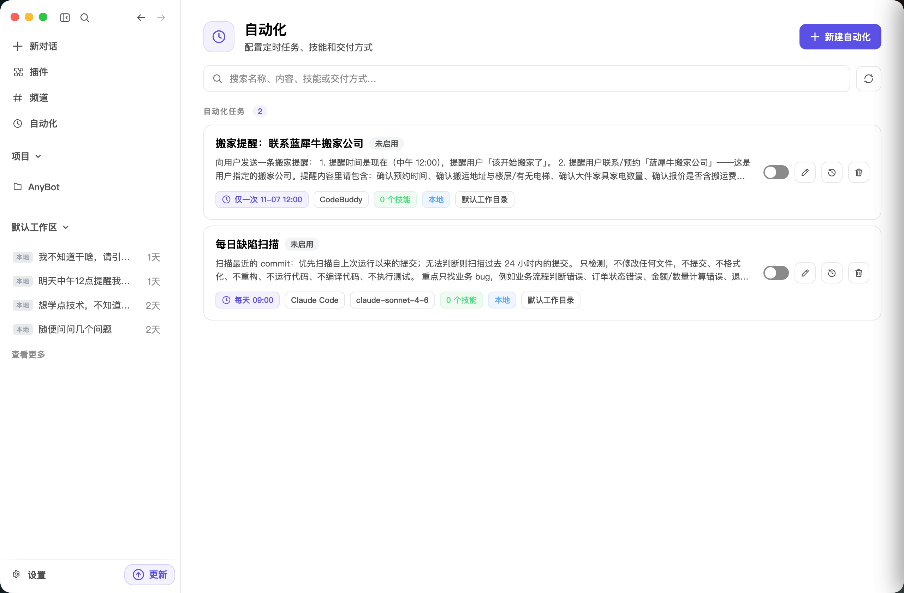
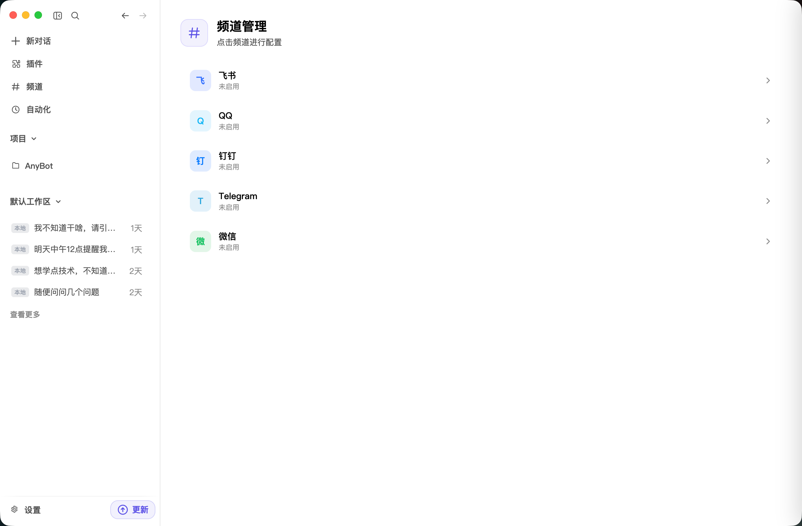
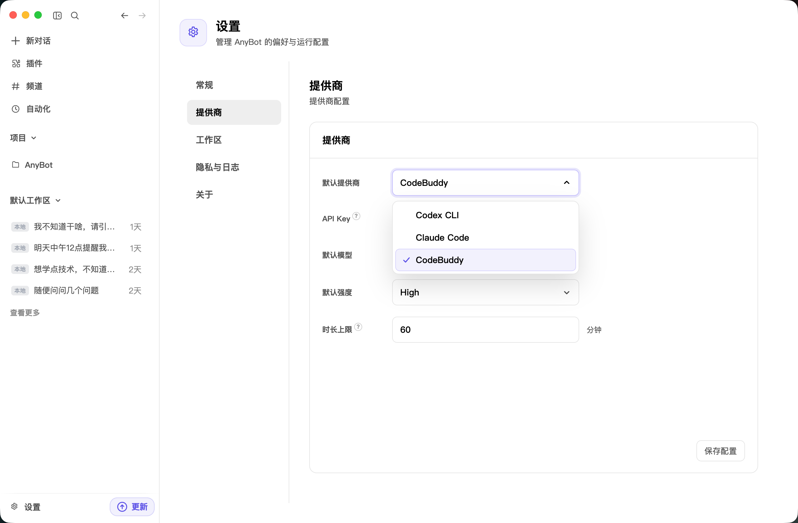
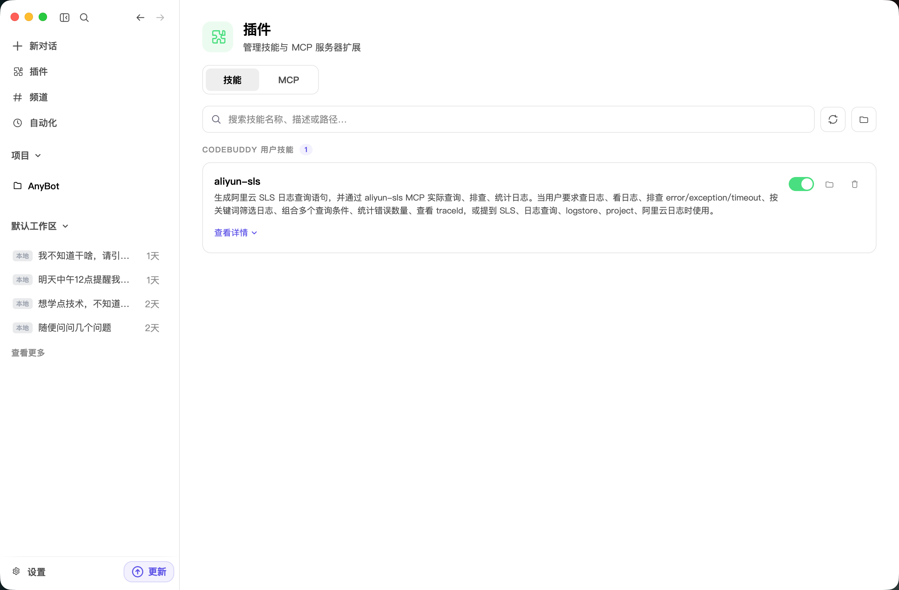
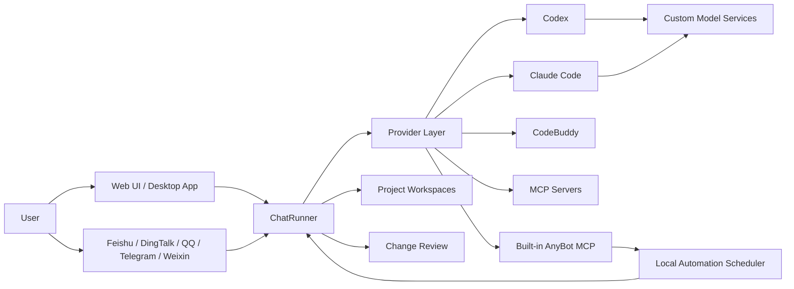

**English** | [中文](./README_CN.md)

<div align="center">
  
  <h1>AnyBot</h1>
  <p>Your local AI Coding Agent console — one entry point for desktop, web, and chat channels.</p>

  <p>
    <a href="https://github.com/1935417243/AnyBot/actions/workflows/build-portable.yml"></a>
    
    
    
    
    
  </p>

  <p>
    <a href="#quick-start">Quick Start</a> ·
    <a href="#usage-guide">Usage Guide</a> ·
    <a href="#providers-and-models">Providers &amp; Models</a> ·
    <a href="#channels">Channels</a> ·
    <a href="#automations">Automations</a> ·
    <a href="#faq">FAQ</a> ·
    <a href="#developer-docs">Developer Docs</a>
  </p>
</div>

AnyBot is a local AI Coding Agent console and remote entry point. Drive and manage **Codex, Claude Code, and CodeBuddy** on your computer from the desktop app, the Web UI, or chat channels such as Weixin, QQ, Telegram, Feishu, and DingTalk.

- **Ready out of the box**: the desktop app needs neither Node.js nor a global CLI. Pick a Provider in settings and download its runtime with one click.
- **Bring your own models**: configure separate upstreams and model mappings for Codex / Claude Code to use DeepSeek, Kimi, MiniMax, Aliyun Token Plan, VibeAPI, Ollama, llama, and more. These settings only apply inside AnyBot and leave your global CLI config untouched.
- **Your data stays local**: sessions, projects, automations, and settings are stored on your machine, and automations are triggered by a local scheduler with no cloud dependency.

The desktop app supports **macOS** and **Windows**; running from source supports **macOS**, **Linux**, and **Windows**.

---

## Features

**Agents and models**

- **Multiple Providers**: switch between Codex, Claude Code, and CodeBuddy at any time; each Provider remembers its last model. In native mode, Codex fetches the models available to your account live.
- **Compatible model access**: Codex supports custom Responses / Anthropic upstreams, and Claude Code supports Anthropic-compatible endpoints. Temperature can be tuned for local Ollama / llama models.
- **MCP servers**: add, check, and manage MCP Servers from the Plugins page; one config serves all three Providers. A built-in AnyBot MCP lets the Agent create and manage automations directly in chat.
- **Skills**: isolated per Provider; browse, enable, disable, and delete them. Codex / Claude Code can also install selected official skills.

**Chat and projects**

- **Agent Web UI**: Markdown, code highlighting, streamed Agent activity, cancellation, `/compact` context compaction, context usage, and persistent history.
- **Project workspaces**: add projects from a local folder or a Git repository and view or switch branches; project sessions use the project directory as the Agent working directory.
- **Smarter input**: `/` picks skills, projects, and Provider commands; `@` references project files; attachments via button, paste, or drag and drop.
- **Session navigation**: `⌘K` / `Ctrl+K` searches sessions by title and message content; back / forward moves between sessions and pages.
- **Agent questions**: when CodeBuddy needs a decision, a question card pops up; the Agent continues after you answer.
- **Change review**: inspect diffs after Agent edits and approve or revert each turn.
- **Code and diagram previews**: preview HTML, Mermaid, and SVG code blocks, download HTML / SVG, or save Mermaid as a high-resolution PNG.

**Automation and remote access**

- **Automations**: run once, every N minutes, hourly, daily, weekly, or on a Cron schedule. Activity is visible in the Web UI, and results can be kept locally or delivered to a channel.
- **Channel integrations**: Feishu long connection, DingTalk Stream, QQ Bot WebSocket, Telegram long polling, and personal Weixin.
- **Proactive messaging**: local scripts can push notifications to bound channel owners through `/api/send`.

**Desktop experience**

- Collapsible sidebar, Open Folder from the home page, tray, and launch at login. Windows installer builds update in-app; other platforms can check the latest GitHub release from the About page.

---

## Screenshots

<table>
  <tr>
    <td></td>
    <td></td>
  </tr>
  <tr>
    <td></td>
    <td></td>
  </tr>
  <tr>
    <td></td>
    <td></td>
  </tr>
  <tr>
    <td></td>
    <td></td>
  </tr>
</table>

---

## Quick Start

### 1. Install the Desktop App (Recommended)

Download the package for your platform from [GitHub Releases](https://github.com/1935417243/AnyBot/releases):

| Platform | Package | Notes |
|----------|---------|-------|
| Windows | `AnyBot-Setup-x.x.x.exe` | Install, then launch from the Start Menu or desktop shortcut |
| macOS | `AnyBot-x.x.x-*.dmg` | Open the `.dmg`, drag `AnyBot.app` into Applications, then launch |

> If macOS says the app is damaged, see the [FAQ](#faq).

### 2. Configure a Provider

Open **Settings -> Providers** (设置 -> 提供商) and select at least one Provider. If it shows “需下载” (download required), click “立即下载” (Download now) and wait until the component is ready, then configure the account or service:

| Provider | Setup |
|----------|-------|
| Codex | Reuse your local Codex CLI login / config, or enable **Custom upstream** (自定义上游), choose Responses / Anthropic, and enter the endpoint, key, and model mappings |
| Claude Code | Reuse your local Claude Code config, or enable the **Anthropic-compatible interface** and enter service settings. See the [Claude Code docs](https://code.claude.com/docs/en/overview) |
| CodeBuddy | Enter an official service API Key, or leave it empty to reuse existing CLI login credentials |

See [Providers and Models](#providers-and-models) for more connection options.

### 3. Start Chatting

Back on the home page, pick a project or add one with “打开文件夹” (Open Folder), then send a message. Choose “不在项目中工作” (Not in a project) to chat without a project.

### 4. Run From Source (Optional)

Use **Node.js 22** to match CI:

```bash
git clone https://github.com/1935417243/AnyBot.git
cd AnyBot
npm ci
npm start
```

Then open `http://localhost:19981`. To keep it running in the background:

```bash
npm run bot:start    # start in background
npm run bot:status   # show status
npm run bot:stop     # stop
```

---

## Usage Guide

### Projects and Workspace

- **Project sessions**: add a local folder or clone a Git repository from the sidebar, and view or switch branches. Project sessions use the project directory as the Agent working directory; the project's own `AGENTS.md` / `CLAUDE.md` files are read natively by each Provider.
- **Normal chats**: use the default working directory under **Settings -> Workspace** (设置 -> 工作区). The desktop app defaults to `~/AnyBotData` (on Windows, `AnyBotWorkspace` under your home folder or the install drive root); source runs default to the launch directory.
- **Workspace memory**: the default working directory is seeded with `AGENTS.md` (collaboration rules and persona) and `MEMORY.md` (identity, user profile, tool settings, and lessons learned) templates. Normal chats inject them into the first-turn prompt, and the Agent keeps `MEMORY.md` up to date during conversations. An unfilled `MEMORY.md` template is not injected.

### Input Box

| Action | Description |
|--------|-------------|
| `/` | Shows skills and implemented native commands for the current Provider, plus projects (available globally). Selected skills inject only their names for the turn; selected projects inject names and absolute paths |
| `@` | References files in the current project or working directory. Git repositories are listed via `git ls-files`; non-Git directories are scanned using every level of `.gitignore`, excluding dependencies and build output |
| Attachments | Upload by button, pasted images, or drag and drop; 50MB per file. Image input depends on the current Provider |
| `/compact` | Compacts the current session context |

In a project session, `/` does not list the session's own project; only additional projects are added to the prompt.

### Keyboard Shortcuts

| Action | macOS | Windows / Linux |
|--------|-------|-----------------|
| Search sessions | `⌘K` | `Ctrl+K` |
| Back / Forward | `⌘[` / `⌘]` | `Alt+←` / `Alt+→` |

Back / Forward also works with mouse side buttons and moves between sessions, new chats, and the Plugins, Channels, Automations, and Settings pages.

### Agent Activity, Questions, and Change Review

- **Streamed activity**: see the Agent's reasoning, tool calls, and output in real time, and stop a response at any time.
- **Agent questions**: when CodeBuddy calls `AskUserQuestion`, a question card appears above the input box with single / multi-select, free-form answers, multi-question paging, and skip; the card is restored after a page reload. Currently only available for CodeBuddy sessions in the Web UI, and not in read-only permission mode.
- **Change review**: after Agent edits, a change snapshot lets you inspect diffs and approve or revert. Read-only permission mode skips snapshots.
- **Code and diagram previews**: HTML / Mermaid / SVG preview cards load on demand. The card menu lets you view or copy source, download HTML / SVG, and save Mermaid as a high-resolution PNG. Diagram requests default to Mermaid output.

---

## Providers and Models

| Provider | SDK | Image input | Key capabilities |
|----------|-----|-------------|------------------|
| `codex` | Codex SDK | Supported | Session resume, sandbox, Agent events, context usage, MCP; native mode fetches your account's models live |
| `claude-code` | Claude Agent SDK | Not yet | Session resume, permission modes, context compaction, streamed Agent events, MCP |
| `codebuddy` | Tencent Agent SDK | Not yet | Session resume, permission modes, streamed Agent events, Agent questions, skills, MCP; model list retrieved from the service |

Desktop builds download CLI components on demand, so no global install is needed. Source runs can use the runtime shipped with each SDK, or point to an external CLI path in settings.

### Compatible Model Access

Choose the connection mode that matches the service's API protocol:

| Provider setting | Connection |
|------------------|------------|
| Codex: Custom upstream → Responses | Codex calls an upstream that supports the OpenAI Responses API directly |
| Codex: Custom upstream → Anthropic | AnyBot's local adapter translates requests to the Anthropic Messages API |
| Claude Code: Anthropic-compatible interface | Calls an Anthropic API-compatible service |

- Anthropic Base URL suggestions include DeepSeek, Kimi, MiniMax, Aliyun Token Plan, VibeAPI, Ollama (local), and llama (local); you can also enter any other URL.
- With Codex **Custom upstream** enabled, the chat box uses the aliases `gpt-5.6-sol`, `gpt-mini`, and `gpt-codex`; the actual upstream models come from the mappings in settings.
- The Claude Code compatibility interface maintains mappings by purpose: Auto, Opus, Sonnet, Haiku / Fast, and Subagent.
- When enabled, Codex uses an isolated `CODEX_HOME` and Claude Code uses an isolated `CLAUDE_CONFIG_DIR`, separate from your global config.
- CodeBuddy currently uses its official service only and does not offer a custom compatibility endpoint.

### Local Ollama / llama Models

Start the local model service, then select Ollama or llama in the Anthropic connection settings and enter the model name. Suggested addresses are `http://localhost:11434?anybot=ollama` and `http://localhost:8080?anybot=llama`. Keep the `anybot` marker when using a custom port; AnyBot strips it before sending requests. The API Key can be left empty for local services.

When Claude Code connects to these local backends, the effort slider becomes a **0.0–1.0 temperature control**, and AnyBot adapts mid-conversation system messages that local model templates cannot handle.

---

## Channels

Enable and configure channels from the **Channels** page in the sidebar. Support varies by platform protocol:

| Channel | Transport | Input | Output | Notes |
|---------|-----------|-------|--------|-------|
| Feishu | Long connection events | Text, images | Text, images, `FILE:` files | Group chats reply on mention by default; can reply to all |
| DingTalk | Stream robot events | Text, images, files | Markdown, images, `FILE:` files | Attachments limited to 20MB |
| QQ Bot | WebSocket gateway | Text, images, files | Markdown, images | Guild, group, and C2C/direct events; non-image files are returned as local paths |
| Telegram | Bot API long polling | Text, images | Text | Captions are included as context; long replies are split |
| Personal Weixin | Weixin channel protocol | Text, images, files | Text, images, `FILE:` files | QR code binding |

The first direct message to the bot records the Owner (`ownerChatId`) automatically, which is used for proactive messaging and automation delivery; Weixin records it during QR binding.

Channel commands: `/help`, `/new`, `/provider`, `/model`, and `/workspace`. You can also send `provider 1`, `model 1`, or `workspace 1` to switch by number.

### Platform Setup

- **Feishu**: create an app on the Feishu Open Platform, enable bot capability and long connection mode, subscribe to `im.message.receive_v1`, and grant message sending permissions. To handle images, also grant message resource read permissions.
- **DingTalk**: create a Stream robot app on the DingTalk Open Platform and enter the App Key and App Secret. AnyBot caches `robotCode` automatically after the robot receives a message.
- **QQ Bot**: create a bot app on the QQ Open Platform, get the App ID and App Secret, and configure message receive permissions.
- **Telegram**: create a bot with [@BotFather](https://t.me/BotFather) and get the Bot Token. In groups, mention the bot or use commands with the bot name to trigger replies.
- **Personal Weixin**: after enabling the channel, the first startup shows a QR code. Scan it with personal Weixin to bind; AnyBot then writes back `accountId`, `token`, and `ownerChatId`.

<details>
<summary><b>Channel config file <code>.data/channels.json</code></b></summary>

Managing channels from the Web UI is recommended; this is for reference only:

```jsonc
{
  "feishu": {
    "enabled": false,
    "appId": "",
    "appSecret": "",
    "groupChatMode": "mention",
    "botOpenId": "",
    "ackReaction": "OK",
    "ownerChatId": ""
  },
  "qqbot": {
    "enabled": false,
    "appId": "",
    "appSecret": "",
    "ownerChatId": ""
  },
  "dingtalk": {
    "enabled": false,
    "appId": "",
    "appSecret": "",
    "robotCode": "",
    "ownerChatId": ""
  },
  "telegram": {
    "enabled": false,
    "token": "",
    "ownerChatId": ""
  },
  "weixin": {
    "enabled": false,
    "accountId": "",
    "token": "",
    "baseUrl": "https://ilinkai.weixin.qq.com",
    "botType": "3",
    "botAgent": "",
    "ownerChatId": ""
  }
}
```

When `weixin.botAgent` is empty, it is generated from the current app version as `AnyBot/<version>`.

</details>

---

## Skills and MCP

Skills and MCP servers are both managed from the **Plugins** page in the sidebar.

### Skills

Skill directories are isolated per Provider, and the `/` picker only shows skills for the current Provider:

| Provider | Skill directory |
|----------|-----------------|
| `codex` | `~/.agents/skills/` and `$CODEX_HOME/skills/` (default `~/.codex/skills/`); custom upstream mode maps the latter into `codex/skills/` under AnyBot's runtime data directory |
| `claude-code` | `$CLAUDE_CONFIG_DIR/skills/` (default `~/.claude/skills/`); compatibility mode maps it into `claude-code/skills/` under AnyBot's runtime data directory |
| `codebuddy` | `~/.codebuddy/skills/` |

- The Plugins page can browse and install selected official skills for Codex / Claude Code from `openai/skills` and `anthropics/skills`; Codex official skills go into `~/.agents/skills/`.
- Enabling or disabling a skill switches its file between `SKILL.md` and `SKILL.md.disabled`, which also affects external CLIs that share the same skill directory.

### MCP Servers

- In the Plugins page's "MCP Servers" tab, paste an `mcpServers` JSON object or a single Server config containing `command` / `url`; `stdio`, `http`, and `sse` types are supported.
- Enabled MCP Servers are checked on app startup; you can also refresh, recheck, view logs, disable, or delete them.
- The same config is passed to Codex, Claude Code, and CodeBuddy, and is stored in `.data/app-settings.json`.

### Built-in AnyBot MCP

AnyBot automatically injects a built-in MCP Server (`anybot`) into every chat run, providing the `automation_options`, `automation_list`, `automation_create`, `automation_update`, and `automation_delete` tools. Just tell the Agent something like "check this project's dependency updates every weekday at 9 AM" and it will create the automation for you.

- Credentials are issued per run; no manual setup is needed.
- When injected, the session-scoped scheduling tools that ship with Claude Code / CodeBuddy (such as `CronCreate`) are disabled so that AnyBot's local scheduler handles everything.
- Runs triggered by automations do not receive it, so tasks cannot create more tasks.

---

## Automations

Automations run on your own machine without any cloud service. Create them from the **Automations** page in the sidebar, or ask the Agent to create them through the [built-in AnyBot MCP](#built-in-anybot-mcp).

| Trigger | Description |
|---------|-------------|
| Once | Runs once at the scheduled time and then disables itself; if missed by no more than 5 minutes at app startup, it still runs once |
| Every N minutes / Hourly | Runs at a fixed interval |
| Daily / Weekly | Runs at a set time (and weekday) |
| Cron | Standard 5-field Cron expression, e.g. `0 9 * * 1-5` |

- On startup, the app loads enabled tasks and uses a local timer to fire them at `nextRunAt`. Recurring runs missed while the app was closed or the computer was asleep are not replayed; AnyBot calculates the next future run instead.
- Each run creates a new local session and goes through the full chat pipeline, so Provider, model, project directory, skills, activity display, message persistence, and change review behave like a normal chat.
- Delivery only controls the final output: "Local" keeps the result in run history, while channel delivery keeps the full process in the app and sends only the final result to the channel.

---

## Local API and Proactive Messaging

AnyBot exposes a lightweight local API so scripts can push notifications, such as deployment results or scheduled task output, to bound channel owners.

`/api` requires authentication: a random token is generated at startup and written to `.data/api-token` (override with `ANYBOT_API_TOKEN`). Pass it via the `Authorization: Bearer` header or the `?token=` query parameter.

```bash
TOKEN=$(cat .data/api-token)
curl -X POST http://localhost:19981/api/send \
  -H "Authorization: Bearer $TOKEN" \
  -H "Content-Type: application/json" \
  -d '{"channel": "telegram", "message": "Deploy finished"}'
```

`channel` can be `feishu`, `dingtalk`, `qqbot`, `telegram`, or `weixin`. The target channel needs an `ownerChatId`.

---

## Runtime Data

Runtime data defaults to `.data/`, and logs go to `.run/` (single-line JSON split by time, kept for 3 days by default). The desktop app uses Electron's user data directory and keeps `.data/`, `.run/`, and uploads there.

- Source runs can override the data directory with `DATA_DIR` or `CODEX_DATA_DIR`.
- The app does not read `.env` files; manage common settings from the Web UI.
- Data exports mask secrets by default. To migrate credentials, explicitly call `/api/data/export?includeSecrets=1` with an API token.

<details>
<summary><b>Common files</b></summary>

| Path | Contents |
|------|----------|
| `.data/chat.db` | Sessions, messages, projects, and automations |
| `.data/app-settings.json` | App settings, Provider runtime config, and MCP Server config |
| `.data/model-config.json` | Provider and model selection |
| `.data/runtime-config.json` | Sandbox / permission defaults |
| `.data/channels.json` | Channel config |
| `.data/api-token` | Local API auth token (mode 0600) |
| `.data/proxy.json` | Proxy config |
| `.data/disabled-skills.json` | Skill enabled state |
| `.data/change-reviews/` | Change review snapshots |
| `.data/codex/` | Isolated `CODEX_HOME` for Codex custom upstream mode, including sessions and skills |
| `.data/claude-code/` | Isolated `CLAUDE_CONFIG_DIR` for the Claude Code compatibility interface |

</details>

---

## FAQ

<details>
<summary><b>macOS says the app is damaged and can't be opened</b></summary>

If the package came from AnyBot's GitHub Releases, clear the quarantine attribute:

```bash
sudo xattr -rd com.apple.quarantine "/Applications/AnyBot.app"
```

If your app is named `Anybot.app`, adjust the path accordingly.

</details>

<details>
<summary><b>How do I update to a new version?</b></summary>

- **Windows installer**: check, download, and restart to install from **Settings -> About -> Check for updates** (设置 -> 关于 -> 检测更新).
- **macOS**: download the new `.dmg` and overwrite the existing app.
- **Source**: `git pull`, run `npm ci` again, and restart. The About page can also check the latest GitHub release.

</details>

<details>
<summary><b>The Weixin channel login expired. What now?</b></summary>

Clear `weixin.token` in the channel config and restart, then scan the QR code again to rebind.

</details>

<details>
<summary><b>Why doesn't a channel receive proactive messages or automation results?</b></summary>

Both require the target channel to have an `ownerChatId`. Send the bot one direct message first (for Weixin, complete QR binding) so AnyBot records it, then confirm the Owner is filled in on the Channels page.

</details>

---

## Developer Docs

<details>
<summary><b>Architecture, project structure, and development commands</b></summary>

### Architecture



### How It Works

- `src/index.ts` starts the Providers, Web service, enabled channels, automation scheduler, desktop update checks, and MCP Server startup checks, and shuts down gracefully on SIGTERM/SIGINT.
- `src/chat-runner.ts` is the shared orchestration layer for the Web UI, channels, and automations. It handles Provider sessions, project working directories, prompts, message persistence, streamed events, change review, and built-in MCP credentials.
- `src/automation-scheduler.ts` is the local automation scheduler; it fires due tasks, records run history, and delivers final results.
- Web and channel sessions bind to native Provider sessions, and follow-up messages use session resume to keep context.
- Web UI uploads are saved under `tmp/uploads/` in the working directory. Local image paths and `FILE: /path/to/file.ext` directives in Agent replies are uploaded only for channels that support returning attachments.

### Project Structure

```text
AnyBot/
├── src/
│   ├── index.ts                    # Process entry
│   ├── chat-runner.ts              # Session orchestration: Provider calls, events, change review, persistence
│   ├── automation-scheduler.ts     # Local automation scheduling, run history, delivery
│   ├── app-settings.ts             # App settings
│   ├── sandbox-config.ts           # Provider sandbox / permission modes
│   ├── mcp-config.ts               # MCP config transformation (incl. built-in AnyBot MCP)
│   ├── prompt.ts                   # System prompt and workspace memory injection
│   ├── cli-runtime/                # CLI manifests, on-demand downloads, integrity checks
│   ├── providers/                  # Provider adapters (Codex / Claude Code / CodeBuddy)
│   ├── channels/                   # Weixin, Telegram, Feishu, DingTalk, QQ
│   ├── web/                        # Express API, SQLite storage, Web UI
│   │   ├── routes/                 # Domain route modules
│   │   ├── services/               # Business logic and pure helpers
│   │   └── public/                 # Build-free HTML / CSS / ES modules
│   └── agent/md_files/             # Workspace AGENTS.md / MEMORY.md templates
├── electron/                       # Electron desktop entry and packaging hooks
├── scripts/                        # Build, release assets, daemon helper
├── installer/windows/              # Windows installer config
├── build/icons/                    # Desktop icons
└── assets/                         # README screenshots and media
```

See [AGENTS.md](./AGENTS.md) for detailed module boundaries and conventions.

### Development

```bash
npm ci                  # install dependencies
npm run dev             # tsx watch dev mode
npm run check           # type check
npm run build           # compile to dist/
npm run build:release   # compile and copy release assets
npm run electron:dev    # build, then launch Electron
npm run electron:build  # build desktop packages
```

Run `npm run check` before submitting changes. For desktop shell, release asset, or installer changes, also run the relevant build / electron command.

### Adding a Provider

1. Implement `IProvider` under `src/providers/`.
2. Register the Provider factory in `src/providers/index.ts`.
3. Add runtime config handling in `src/app-settings.ts` and `src/providers/index.ts`.
4. For on-demand CLI downloads, add a component manifest under `src/cli-runtime/`.
5. If the Provider exposes Web UI slash commands, implement `listSlashCommands()` and make sure the backend can handle them reliably.

Use `src/providers/codex.ts` and `src/providers/claude-code.ts` as references.

</details>

---

## Release Notes

See [release-notes.md](./release-notes.md) for the current release and [GitHub Releases](https://github.com/1935417243/AnyBot/releases) for previous versions.

## Contributing

Issues and pull requests are welcome. Please run `npm run check` before submitting changes.

## License

MIT — see [LICENSE](./LICENSE).
