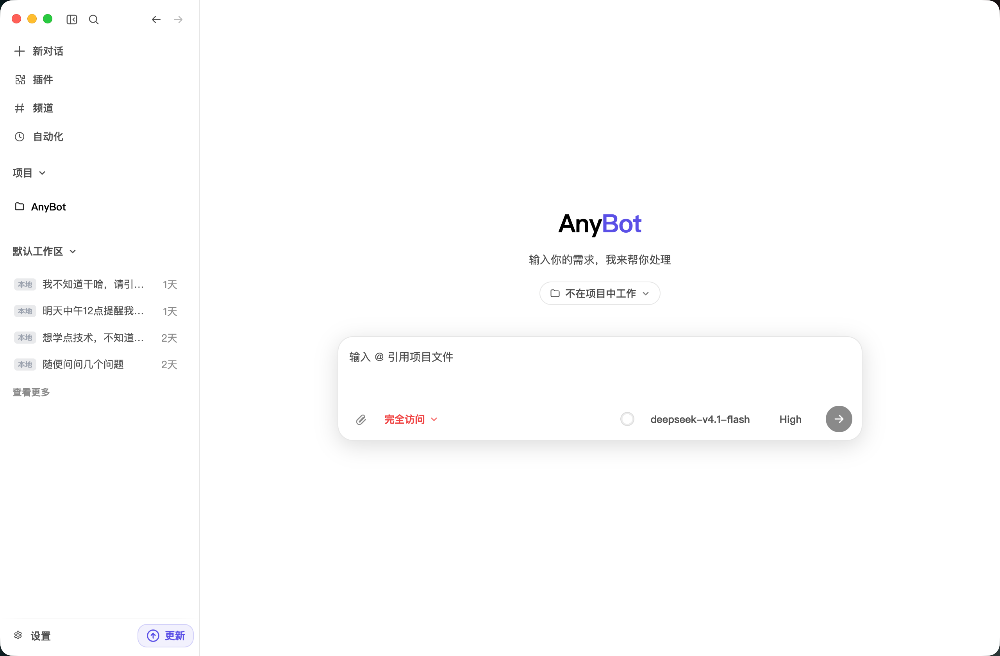
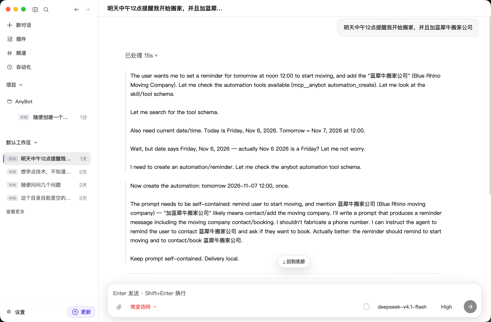
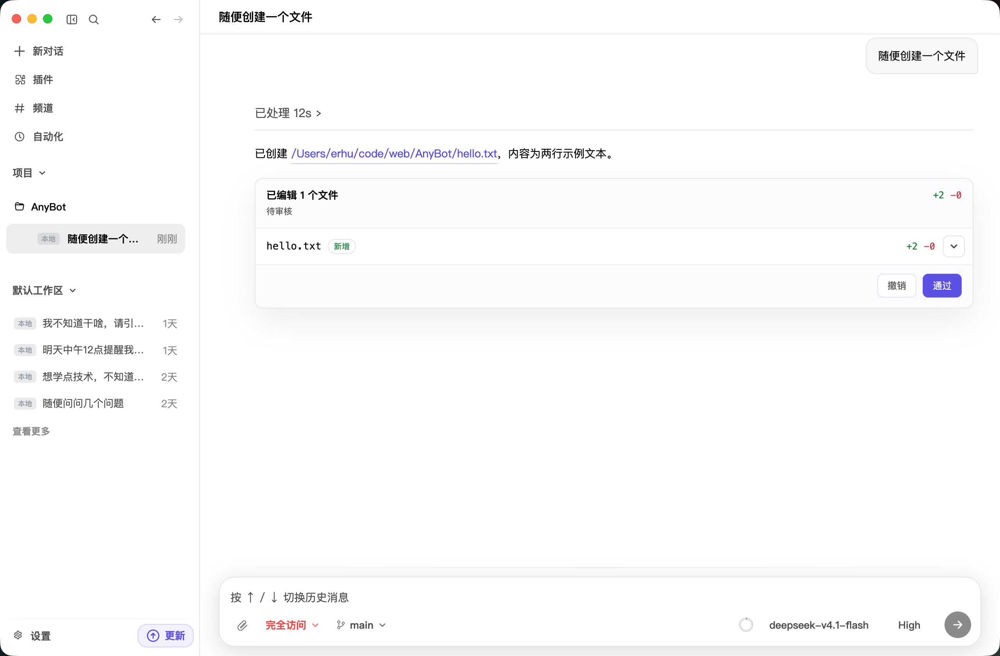
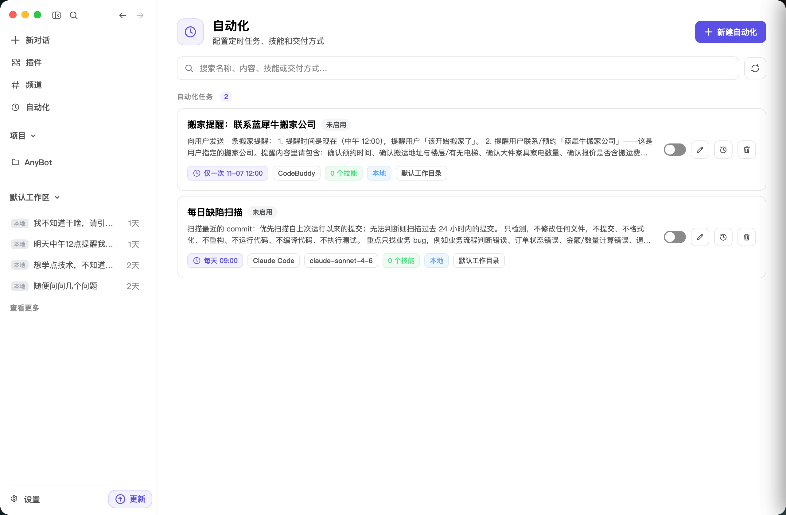
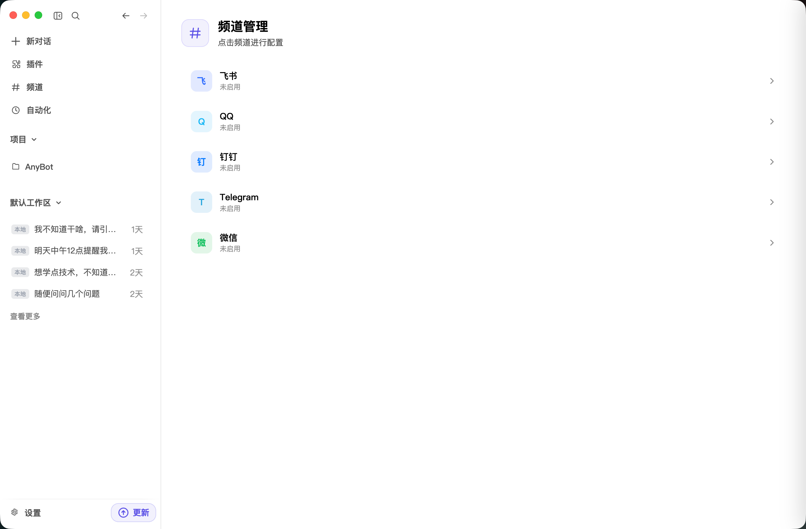
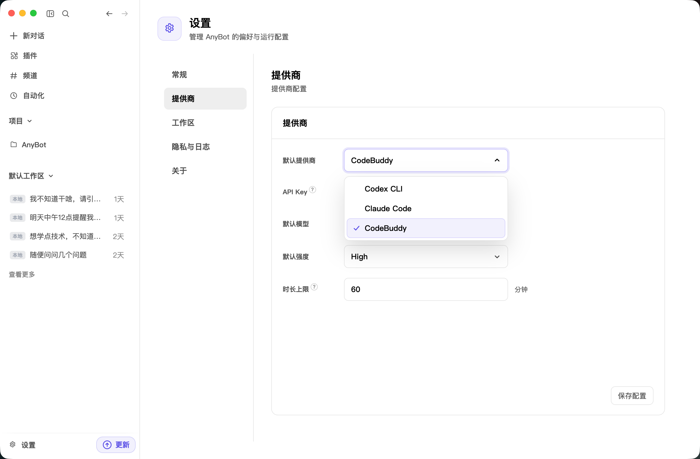
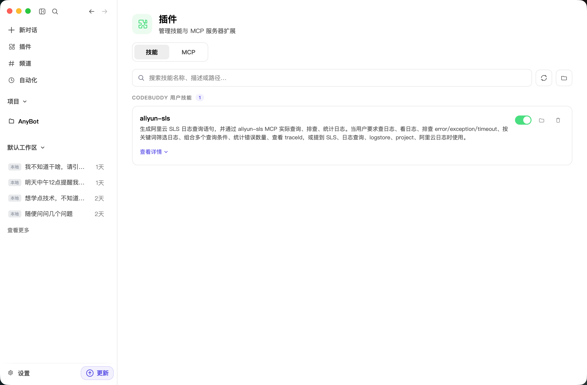
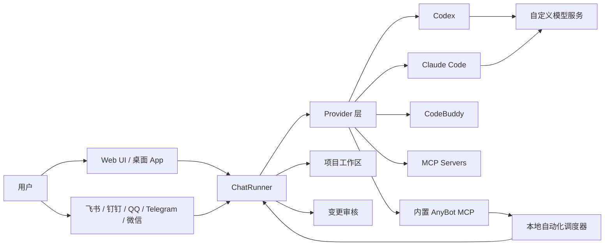

[English](./README.md) | **中文**

<div align="center">
  
  <h1>AnyBot</h1>
  <p>本机 AI Coding Agent 控制台，桌面端、网页和聊天频道一个入口。</p>

  <p>
    <a href="https://github.com/1935417243/AnyBot/actions/workflows/build-portable.yml"></a>
    
    
    
    
    
  </p>

  <p>
    <a href="#快速开始">快速开始</a> ·
    <a href="#使用指南">使用指南</a> ·
    <a href="#provider-与模型">Provider 与模型</a> ·
    <a href="#频道接入">频道接入</a> ·
    <a href="#自动化任务">自动化</a> ·
    <a href="#常见问题">常见问题</a> ·
    <a href="#开发者文档">开发者文档</a>
  </p>
</div>

AnyBot 是一个本机 AI Coding Agent 控制台与远程入口：在桌面 App、Web UI，或微信、QQ、Telegram、飞书、钉钉等聊天频道里，就能驱动和管理电脑上的 **Codex、Claude Code、CodeBuddy**。

- **开箱即用**：桌面版不需要安装 Node.js 或全局 CLI，在设置页选择 Provider 后一键下载运行组件。
- **模型自由**：可为 Codex / Claude Code 单独配置上游和模型映射，接入 DeepSeek、Kimi、MiniMax、阿里 Token Plan、VibeAPI、Ollama、llama 等服务，配置只在 AnyBot 内生效，不影响本机全局 CLI。
- **数据在本地**：会话、项目、自动化和配置都保存在本机，自动化由本地调度器触发，不依赖云端服务。

桌面 App 支持 **macOS** 和 **Windows**；源码运行支持 **macOS**、**Linux** 和 **Windows**。

---

## 特性

**Agent 与模型**

- **多 Provider**：Codex、Claude Code、CodeBuddy 随时切换，每个 Provider 记住上次选择的模型；Codex 原生模式实时拉取账号可用模型。
- **兼容模型接入**：Codex 支持自定义 Responses / Anthropic 上游，Claude Code 支持 Anthropic 兼容接口；连接 Ollama / llama 本地模型时可调节温度。
- **MCP 服务器**：在插件页统一添加、检查和管理 MCP Server，同一份配置供三个 Provider 使用；内置 AnyBot MCP，让 Agent 在对话中直接创建和管理自动化任务。
- **技能管理**：技能按 Provider 隔离，可浏览、启用、禁用、删除；Codex / Claude Code 支持选装官方技能。

**对话与项目**

- **Agent Web UI**：Markdown、代码高亮、流式 Agent 过程、停止响应、`/compact` 上下文压缩、上下文用量展示和持久化会话历史。
- **项目工作区**：从本地文件夹或 Git 仓库添加项目，查看和切换分支；项目会话以项目目录作为 Agent 工作目录。
- **输入增强**：`/` 选择技能、项目和 Provider 命令，`@` 引用项目文件，支持按钮、粘贴和拖拽上传附件。
- **会话导航**：`⌘K` / `Ctrl+K` 按标题和消息内容搜索会话，前进 / 后退在会话和各页面之间跳转。
- **Agent 提问**：CodeBuddy 需要用户决策时弹出提问卡片，选择或填写后 Agent 继续执行。
- **变更审核**：Agent 修改文件后可查看 diff，逐轮通过或撤销。
- **代码与图表预览**：HTML、Mermaid、SVG 代码块直接预览，可下载 HTML / SVG，或将 Mermaid 保存为高清 PNG。

**自动化与远程**

- **自动化任务**：支持仅一次、每隔几分钟、每小时、每天、每周和 Cron 触发；过程在 Web UI 可查看，结果可保存到本地或推送到频道。
- **多频道接入**：飞书长连接、钉钉 Stream、QQ Bot WebSocket、Telegram 长轮询和个人微信。
- **主动推送**：本机脚本可通过 `/api/send` 把通知推送到已绑定 Owner 的频道。

**桌面体验**

- 侧边栏折叠、首页打开文件夹、托盘常驻和开机启动；Windows 安装版支持应用内更新，其它平台可在关于页检查 GitHub 最新版本。

---

## 截图预览

<table>
  <tr>
    <td></td>
    <td></td>
  </tr>
  <tr>
    <td></td>
    <td></td>
  </tr>
  <tr>
    <td></td>
    <td></td>
  </tr>
  <tr>
    <td></td>
    <td></td>
  </tr>
</table>

---

## 快速开始

### 1. 安装桌面 App（推荐）

从 [GitHub Releases](https://github.com/1935417243/AnyBot/releases) 下载对应平台安装包：

| 平台 | 安装包 | 说明 |
|------|--------|------|
| Windows | `AnyBot-Setup-x.x.x.exe` | 双击安装后从开始菜单或桌面快捷方式启动 |
| macOS | `AnyBot-x.x.x-*.dmg` | 打开 `.dmg`，将 `AnyBot.app` 拖到 Applications 后启动 |

> macOS 提示“应用已损坏，无法打开”时，见 [常见问题](#常见问题)。

### 2. 配置 Provider

打开 **设置 -> 提供商**，选择至少一个 Provider。若显示“需下载”，点击“立即下载”等待组件就绪，再按下表配置账号或服务：

| Provider | 配置方式 |
|----------|----------|
| Codex | 沿用本机 Codex CLI 的登录 / 配置；或开启 **自定义上游**，选择 Responses / Anthropic 格式并填写地址、密钥和模型映射 |
| Claude Code | 沿用本机 Claude Code 配置；或开启 **Anthropic 兼容接口** 并填写服务配置，参见 [Claude Code 文档](https://code.claude.com/docs/en/overview) |
| CodeBuddy | 填写官方服务 API Key；留空时沿用 CLI 已登录凭据 |

更多接入方式见 [Provider 与模型](#provider-与模型)。

### 3. 开始对话

回到首页选择一个项目，或点“打开文件夹”添加项目，然后发送消息；不需要项目时选择“不在项目中工作”。

### 4. 源码运行（可选）

建议使用 **Node.js 22**，与 CI 环境保持一致：

```bash
git clone https://github.com/1935417243/AnyBot.git
cd AnyBot
npm ci
npm start
```

启动后打开 `http://localhost:19981`。需要后台常驻时：

```bash
npm run bot:start    # 后台启动
npm run bot:status   # 查看状态
npm run bot:stop     # 停止
```

---

## 使用指南

### 项目与工作区

- **项目会话**：在侧边栏添加本地文件夹或克隆 Git 仓库，可查看和切换分支。项目会话以项目目录作为 Agent 工作目录，项目自带的 `AGENTS.md` / `CLAUDE.md` 等由各 Provider 按原生规则读取。
- **普通对话**：使用 **设置 -> 工作区** 中的默认工作目录。桌面版默认是 `~/AnyBotData`（Windows 为用户目录或安装盘根目录下的 `AnyBotWorkspace`），源码运行默认是启动目录。
- **工作区记忆**：默认工作目录会自动放入 `AGENTS.md`（协作规则与性格设定）和 `MEMORY.md`（身份、用户资料、工具设置与经验教训）模板。普通对话的首轮会把它们注入提示词，Agent 也会在对话中主动维护 `MEMORY.md`；未填写的 `MEMORY.md` 模板不会注入。

### 输入框

| 操作 | 说明 |
|------|------|
| `/` | 按当前 Provider 展示技能和已实现的原生命令，并可选择项目（全局可选）。技能只把技能名写入本轮提示词；项目按项目名和绝对路径写入 |
| `@` | 引用当前项目或工作目录中的文件。Git 仓库按 `git ls-files` 列出，非 Git 目录按各级 `.gitignore` 扫描并排除依赖和构建产物 |
| 附件 | 按钮选择、粘贴图片或拖拽上传，单文件上限 50MB；图片输入取决于当前 Provider |
| `/compact` | 压缩当前会话上下文 |

项目会话中 `/` 不会重复展示当前项目，额外选择的其它项目才写入本轮提示词。

### 快捷键

| 功能 | macOS | Windows / Linux |
|------|-------|-----------------|
| 搜索会话 | `⌘K` | `Ctrl+K` |
| 后退 / 前进 | `⌘[` / `⌘]` | `Alt+←` / `Alt+→` |

后退 / 前进也支持鼠标侧键，会在会话、新对话以及插件、频道、自动化、设置页之间跳转。

### Agent 过程、提问与变更审核

- **流式过程**：实时展示 Agent 的思考、工具调用和输出，可随时停止响应。
- **Agent 提问**：CodeBuddy 调用 `AskUserQuestion` 时，输入框上方弹出提问卡片，支持单选 / 多选、自由填写、多题翻页和跳过；刷新页面后卡片可恢复。目前仅 WebUI 中的 CodeBuddy 会话支持，只读权限模式下不可用。
- **变更审核**：Agent 修改文件后生成变更快照，可查看 diff 并通过或撤销；只读权限模式下不生成快照。
- **代码与图表预览**：HTML / Mermaid / SVG 预览卡片按需加载，卡片菜单可查看和复制代码、下载 HTML / SVG、将 Mermaid 保存为高清 PNG。请求流程图、时序图等图示时，Agent 默认输出 Mermaid。

---

## Provider 与模型

| Provider | SDK | 图片输入 | 主要能力 |
|----------|-----|----------|----------|
| `codex` | Codex SDK | 支持 | 会话续聊、Sandbox、Agent 事件、上下文用量、MCP；原生模式实时拉取账号可用模型 |
| `claude-code` | Claude Agent SDK | 暂不支持 | 会话续聊、权限模式、上下文压缩、Agent 流式事件、MCP |
| `codebuddy` | Tencent Agent SDK | 暂不支持 | 会话续聊、权限模式、Agent 流式事件、Agent 提问、技能、MCP，模型清单从服务获取 |

桌面版的 CLI 组件按需下载，不要求全局安装；源码运行可使用 SDK 随附的运行组件，也可在设置中指定外部 CLI 路径。

### 兼容模型接入

在设置页选择与服务实际协议匹配的接入方式：

| Provider 设置 | 接入方式 |
|---------------|----------|
| Codex：自定义上游 → Responses | Codex 直接调用支持 OpenAI Responses API 的上游 |
| Codex：自定义上游 → Anthropic | 经 AnyBot 本地适配层转为 Anthropic Messages API |
| Claude Code：Anthropic 兼容接口 | 调用 Anthropic API 兼容服务 |

- Anthropic 格式的 Base URL 建议项包括 DeepSeek、Kimi、MiniMax、阿里 Token Plan、VibeAPI、Ollama（本地）和 llama（本地），也可手动填写其它地址。
- Codex 开启自定义上游后，聊天框使用 `gpt-5.6-sol`、`gpt-mini`、`gpt-codex` 三个模型别名，实际上游模型由设置页映射决定。
- Claude Code 兼容接口按 Auto、Opus、Sonnet、Haiku / Fast、Subagent 等用途维护模型映射。
- 开启后 Codex 使用独立的 `CODEX_HOME`，Claude Code 使用独立的 `CLAUDE_CONFIG_DIR`，与本机全局配置隔离。
- CodeBuddy 目前只接入官方服务，不提供自定义兼容接口。

### Ollama / llama 本地模型

先启动本地模型服务，再在 Anthropic 接入配置中选择 Ollama 或 llama 并填写模型名。建议地址分别为 `http://localhost:11434?anybot=ollama` 和 `http://localhost:8080?anybot=llama`；使用自定义端口时保留 `anybot` 标识，AnyBot 会在发出请求前移除它。本地服务可不填 API Key。

Claude Code 连接上述本地后端时，聊天输入区的强度滑块会切换为 **0.0～1.0 的温度调节**，并自动处理本地模型模板不兼容的对话中间 system 消息。

---

## 频道接入

在侧边栏 **频道** 页启用和配置。不同频道受平台协议限制，支持范围不同：

| 频道 | 接入方式 | 输入 | 输出 | 备注 |
|------|----------|------|------|------|
| 飞书 | 长连接事件订阅 | 文本、图片 | 文本、图片、`FILE:` 文件 | 群聊默认仅 @ 回复，可配置为全部回复 |
| 钉钉 | Stream 机器人事件 | 文本、图片、文件 | Markdown、图片、`FILE:` 文件 | 附件上限 20MB |
| QQ Bot | WebSocket 网关 | 文本、图片、文件 | Markdown、图片 | 支持频道、群聊和 C2C/私聊；非图片文件返回本机路径 |
| Telegram | Bot API 长轮询 | 文本、图片 | 文本 | 图片 caption 作为上下文；长回复自动拆分 |
| 个人微信 | 微信通道协议 | 文本、图片、文件 | 文本、图片、`FILE:` 文件 | 扫码绑定 |

首次私聊机器人时会自动记录 Owner（`ownerChatId`），用于主动推送和自动化交付；微信在扫码绑定时写入。

频道内可用命令：`/help`、`/new`、`/provider`、`/model`、`/workspace`；也可以直接发 `provider 1`、`model 1`、`workspace 1` 按序号切换。

### 平台配置

- **飞书**：在飞书开放平台创建应用，开启机器人能力和长连接模式，订阅 `im.message.receive_v1` 并授予发送消息权限；如需处理图片，还需要读取消息资源相关权限。
- **钉钉**：在钉钉开放平台创建 Stream 机器人应用，填写 App Key 和 App Secret。机器人收到消息后自动缓存 `robotCode`。
- **QQ Bot**：在 QQ 开放平台创建机器人应用，获取 App ID 和 App Secret，并配置消息接收权限。
- **Telegram**：通过 [@BotFather](https://t.me/BotFather) 创建机器人并获取 Bot Token。群组中需要 @ 机器人或使用带 bot 名称的命令触发回复。
- **个人微信**：启用后首次启动会生成二维码，用个人微信扫码确认，成功后自动写回 `accountId`、`token` 和 `ownerChatId`。

<details>
<summary><b>频道配置文件 <code>.data/channels.json</code></b></summary>

推荐在 Web UI 中管理，以下仅供参考：

```jsonc
{
  "feishu": {
    "enabled": false,
    "appId": "",
    "appSecret": "",
    "groupChatMode": "mention",
    "botOpenId": "",
    "ackReaction": "OK",
    "ownerChatId": ""
  },
  "qqbot": {
    "enabled": false,
    "appId": "",
    "appSecret": "",
    "ownerChatId": ""
  },
  "dingtalk": {
    "enabled": false,
    "appId": "",
    "appSecret": "",
    "robotCode": "",
    "ownerChatId": ""
  },
  "telegram": {
    "enabled": false,
    "token": "",
    "ownerChatId": ""
  },
  "weixin": {
    "enabled": false,
    "accountId": "",
    "token": "",
    "baseUrl": "https://ilinkai.weixin.qq.com",
    "botType": "3",
    "botAgent": "",
    "ownerChatId": ""
  }
}
```

`weixin.botAgent` 留空时按当前应用版本生成，格式为 `AnyBot/<版本号>`。

</details>

---

## 技能与 MCP

技能和 MCP 服务器都在侧边栏 **插件** 页管理。

### 技能

技能目录按 Provider 隔离，输入框 `/` 也只展示当前 Provider 的技能：

| Provider | 技能目录 |
|----------|---------|
| `codex` | `~/.agents/skills/` 和 `$CODEX_HOME/skills/`（默认 `~/.codex/skills/`）；自定义上游模式将后者映射到运行数据目录下的 `codex/skills/` |
| `claude-code` | `$CLAUDE_CONFIG_DIR/skills/`（默认 `~/.claude/skills/`）；兼容接口模式映射到运行数据目录下的 `claude-code/skills/` |
| `codebuddy` | `~/.codebuddy/skills/` |

- 插件页可为 Codex / Claude Code 浏览并选装官方技能，来源分别为 `openai/skills` 和 `anthropics/skills`；Codex 官方技能安装到 `~/.agents/skills/`。
- 启用 / 禁用技能会切换目录中的 `SKILL.md` 与 `SKILL.md.disabled`，因此也会影响使用同一技能目录的外部 CLI。

### MCP 服务器

- 在插件页的「MCP 服务器」tab 中粘贴 `mcpServers` JSON，或包含 `command` / `url` 的单个 Server 配置；支持 `stdio`、`http` 和 `sse` 类型。
- 启用的 MCP Server 会在应用启动时校验，也可以手动刷新、重新检查、查看日志、禁用或删除。
- 同一份配置会传给 Codex、Claude Code 和 CodeBuddy，配置保存在 `.data/app-settings.json`。

### 内置 AnyBot MCP

AnyBot 会为每次对话自动注入一个内置 MCP Server（`anybot`），提供 `automation_options`、`automation_list`、`automation_create`、`automation_update`、`automation_delete` 工具。你可以直接对 Agent 说“每个工作日早上 9 点帮我检查一下这个项目的依赖更新”，由 Agent 创建对应的自动化任务。

- 凭证按每次运行单独签发，无需手动配置。
- 注入后会禁用 Claude Code / CodeBuddy 自带的会话级定时工具（如 `CronCreate`），统一由 AnyBot 本地调度。
- 由自动化触发的运行不会注入，避免任务再创建任务。

---

## 自动化任务

自动化运行在本机，不依赖云端服务。可以在侧边栏 **自动化** 页手动创建，也可以在对话中让 Agent 通过 [内置 AnyBot MCP](#内置-anybot-mcp) 创建。

| 触发方式 | 说明 |
|----------|------|
| 仅一次 | 到点执行一次后自动停用；应用启动时如果错过不超过 5 分钟，仍会补跑一次 |
| 每隔几分钟 / 每小时 | 按固定间隔执行 |
| 每天 / 每周 | 在指定时间（和星期）执行 |
| Cron | 标准 5 段 Cron 表达式，例如 `0 9 * * 1-5` |

- 应用启动后加载已启用任务，用本地定时器在 `nextRunAt` 触发；应用关闭或电脑睡眠期间错过的周期任务不会补跑，直接计算下一次执行时间。
- 每次执行都会新建一个本地会话并走完整的对话流程，Provider、模型、项目目录、技能、过程展示、消息落库和变更审核都与普通对话一致。
- 交付方式只决定结果出口：选择“本地”时结果保存在运行记录中；选择频道时，App 内仍保留完整过程，频道只收到最终结果。

---

## 本地 API 与主动推送

AnyBot 提供轻量本地 API，方便脚本把部署结果、定时任务输出等通知推送到已绑定 Owner 的频道。

`/api` 需要鉴权：启动时生成随机 token 写入 `.data/api-token`（可用 `ANYBOT_API_TOKEN` 覆盖），通过 `Authorization: Bearer` 头或 `?token=` 查询参数携带。

```bash
TOKEN=$(cat .data/api-token)
curl -X POST http://localhost:19981/api/send \
  -H "Authorization: Bearer $TOKEN" \
  -H "Content-Type: application/json" \
  -d '{"channel": "telegram", "message": "部署完成"}'
```

`channel` 可选 `feishu`、`dingtalk`、`qqbot`、`telegram`、`weixin`，目标频道需要已有 `ownerChatId`。

---

## 运行数据

默认运行数据写入 `.data/`，日志写入 `.run/`（单行 JSON，按时间分片，默认保留 3 天）。桌面 App 使用 Electron 的用户数据目录，并在其中维护 `.data/`、`.run/` 和上传目录。

- 源码运行可通过 `DATA_DIR` 或 `CODEX_DATA_DIR` 修改数据目录。
- 应用不读取 `.env` 文件，常用配置都在 Web UI 中管理。
- 数据导出默认对密钥脱敏；需要迁移密钥时，携带 API token 调用 `/api/data/export?includeSecrets=1` 显式导出。

<details>
<summary><b>常见文件</b></summary>

| 路径 | 内容 |
|------|------|
| `.data/chat.db` | 会话、消息、项目和自动化 |
| `.data/app-settings.json` | 应用设置、Provider 运行配置和 MCP Server 配置 |
| `.data/model-config.json` | Provider 与模型选择 |
| `.data/runtime-config.json` | Sandbox / 权限默认值 |
| `.data/channels.json` | 频道配置 |
| `.data/api-token` | 本机 API 鉴权 token（mode 0600） |
| `.data/proxy.json` | 代理配置 |
| `.data/disabled-skills.json` | 技能启用状态 |
| `.data/change-reviews/` | 变更审核快照 |
| `.data/codex/` | Codex 自定义上游模式的隔离 `CODEX_HOME`，包含会话和技能数据 |
| `.data/claude-code/` | Claude Code 兼容接口模式的隔离 `CLAUDE_CONFIG_DIR` |

</details>

---

## 常见问题

<details>
<summary><b>macOS 提示“应用已损坏，无法打开”</b></summary>

确认安装包来自 AnyBot 的 GitHub Releases 后，在终端执行：

```bash
sudo xattr -rd com.apple.quarantine "/Applications/AnyBot.app"
```

如果 Applications 中应用名显示为 `Anybot.app`，请把路径改成实际名称。

</details>

<details>
<summary><b>如何更新到新版本？</b></summary>

- **Windows 安装版**：在 **设置 -> 关于 -> 检测更新** 中检查、下载并重启安装。
- **macOS**：下载新版 `.dmg` 覆盖安装。
- **源码运行**：`git pull` 后重新 `npm ci` 并启动。关于页也可以检查 GitHub 最新版本。

</details>

<details>
<summary><b>微信频道登录失效了怎么办？</b></summary>

在频道配置中清空 `weixin.token` 后重启，重新扫码绑定即可。

</details>

<details>
<summary><b>为什么频道收不到主动推送或自动化结果？</b></summary>

主动推送和频道交付都需要目标频道已有 `ownerChatId`。先私聊机器人一次（微信为扫码绑定）让 AnyBot 自动记录，再在频道页确认 Owner 已填入。

</details>

---

## 开发者文档

<details>
<summary><b>架构、项目结构和开发命令</b></summary>

### 架构概览



### 工作原理

- `src/index.ts` 启动 Provider、Web 服务、已启用频道、自动化调度器、桌面更新检查和 MCP Server 启动校验，并在 SIGTERM/SIGINT 时优雅退出。
- `src/chat-runner.ts` 是 Web UI、频道和自动化进入模型调用的统一编排层，负责 Provider session、项目工作目录、prompt、消息落库、流式事件、变更审核和内置 MCP 凭证签发。
- `src/automation-scheduler.ts` 是本地自动化调度器，负责触发到期任务、记录运行历史并交付最终结果。
- Web 会话和频道会话都绑定 Provider 原生 session，后续消息通过续聊机制保持上下文。
- Web UI 上传文件保存到工作目录下的 `tmp/uploads/`；Agent 回复中的本机图片路径和 `FILE: /path/to/file.ext` 只在支持附件回传的频道中上传发送。

### 项目结构

```text
AnyBot/
├── src/
│   ├── index.ts                    # 进程入口
│   ├── chat-runner.ts              # 会话编排：Provider 调用、流式事件、变更审核、消息落库
│   ├── automation-scheduler.ts     # 本地自动化调度、运行记录和结果交付
│   ├── app-settings.ts             # 应用设置读写
│   ├── sandbox-config.ts           # Provider sandbox / 权限模式
│   ├── mcp-config.ts               # MCP 配置转换（含内置 AnyBot MCP）
│   ├── prompt.ts                   # 系统提示词与工作区记忆注入
│   ├── cli-runtime/                # CLI 组件清单、按需下载和完整性校验
│   ├── providers/                  # Provider 适配器（Codex / Claude Code / CodeBuddy）
│   ├── channels/                   # 微信、Telegram、飞书、钉钉、QQ 频道
│   ├── web/                        # Express API、SQLite 存储和 Web UI
│   │   ├── routes/                 # 领域路由
│   │   ├── services/               # 业务逻辑和纯辅助函数
│   │   └── public/                 # 无构建流程的 HTML / CSS / ES modules
│   └── agent/md_files/             # 工作区 AGENTS.md / MEMORY.md 模板
├── electron/                       # Electron 桌面入口与打包后处理
├── scripts/                        # 构建、发布资源和 daemon 辅助脚本
├── installer/windows/              # Windows 安装器配置
├── build/icons/                    # 桌面应用图标
└── assets/                         # README 截图和展示素材
```

更详细的模块边界和约定见 [AGENTS.md](./AGENTS.md)。

### 开发命令

```bash
npm ci                  # 安装依赖
npm run dev             # tsx watch 开发模式
npm run check           # 类型检查
npm run build           # 编译到 dist/
npm run build:release   # 编译并复制发布资源
npm run electron:dev    # 构建后启动 Electron
npm run electron:build  # 构建桌面安装包
```

提交前至少运行 `npm run check`。涉及桌面壳、发布资源或安装包时，运行对应 build / electron 命令。

### 添加新 Provider

1. 在 `src/providers/` 下实现 `IProvider`。
2. 在 `src/providers/index.ts` 中注册 Provider 工厂。
3. 在 `src/app-settings.ts` 和 `src/providers/index.ts` 中接入 Provider 专属运行配置。
4. 如需 CLI 按需下载，在 `src/cli-runtime/` 中补充组件清单。
5. 如需 Web UI slash 命令，实现 `listSlashCommands()`，并确保后端能可靠处理。

可参考 `src/providers/codex.ts` 和 `src/providers/claude-code.ts`。

</details>

---

## 更新日志

本次更新说明见 [release-notes.md](./release-notes.md)，历史版本见 [GitHub Releases](https://github.com/1935417243/AnyBot/releases)。

## 参与贡献

欢迎提交 Issue 和 Pull Request。提交代码前请先运行 `npm run check`。

## License

MIT — 详见 [LICENSE](./LICENSE)。
